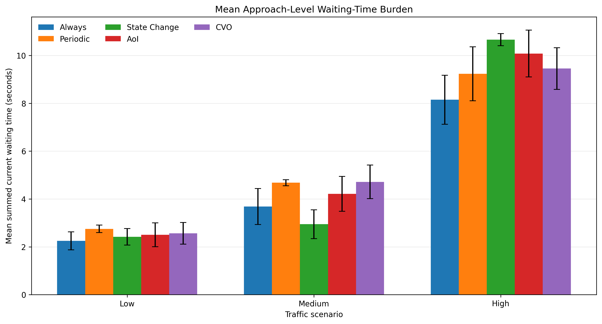
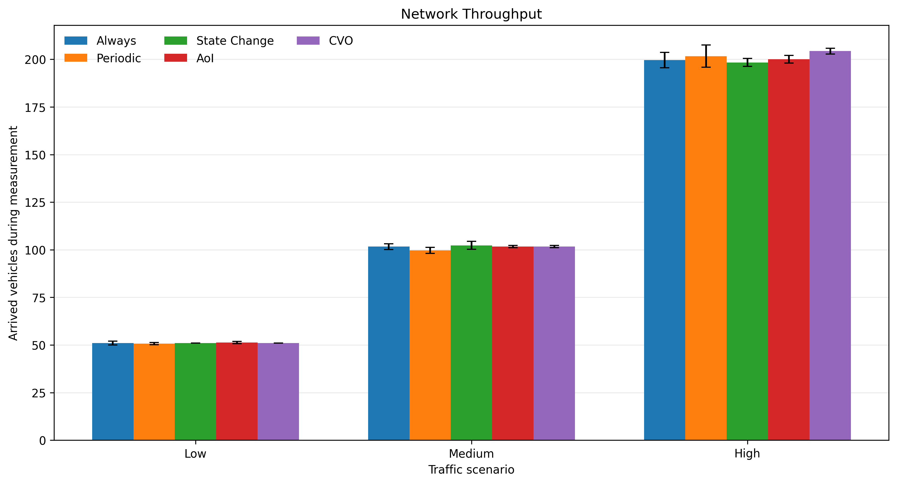

# Control-Value-Aware Adaptive Edge Perception for Communication-Efficient Traffic Signal Control

A SUMO-based research project investigating intelligent traffic observation acquisition using **Control Value of Observation (CVO)** in a five-intersection traffic network.

The project implements and evaluates adaptive observation-acquisition strategies, analyzes their impact on traffic-control performance, and explores additional Machine Learning and Reinforcement Learning approaches.

---

## Table of Contents

1. [Project Overview](#1-project-overview)
2. [System Architecture](#2-system-architecture)
3. [Control Value of Observation](#3-control-value-of-observation)
4. [Observation Cost and Acquisition Decision](#4-observation-cost-and-acquisition-decision)
5. [Observation-Acquisition Strategies](#5-observation-acquisition-strategies)
6. [Network Configuration](#6-network-configuration)
7. [Original Network Experiments](#7-original-network-experiments)
8. [CVO Sensitivity Analysis](#8-cvo-sensitivity-analysis)
9. [Machine Learning Extensions](#9-machine-learning-extensions)
10. [Exploratory Reinforcement Learning](#10-exploratory-reinforcement-learning)
11. [Experimental Visualizations](#11-experimental-visualizations)
12. [Repository Structure](#12-repository-structure)
13. [Configuration Files](#13-configuration-files)
14. [Prerequisites](#14-prerequisites)
15. [Verification and Testing](#15-verification-and-testing)
16. [Limitations](#16-limitations)
17. [Future Work](#17-future-work)

---

## 1. Project Overview

In a network of traffic intersections, continuously acquiring traffic observations can consume sensing, computation, and communication resources.

This project investigates whether an observation should be acquired based on its potential to change the downstream traffic-signal control decision.

The proposed approach uses **Control Value of Observation (CVO)** to compare:

- The action selected using the current traffic belief.
- The action selected using a hypothetical updated belief.

The central principle is to prioritize observations that can influence control decisions instead of acquiring every available observation.

### Main Objectives

- Develop a CVO-based observation-acquisition framework.
- Implement a limited observation budget across multiple intersections.
- Compare CVO with Always-Acquire, Periodic, State-Change, and AoI strategies.
- Evaluate acquisition efficiency and traffic-control performance.
- Analyze CVO sensitivity to decision margins and directional traffic changes.
- Explore Machine Learning models for traffic prediction and learned CVO.
- Investigate single-agent Deep Reinforcement Learning for traffic-signal control.

---

## 2. System Architecture

The project is organized into seven primary Python modules.

| Module | Responsibility |
|---|---|
| `src/perception/` | Traffic-state representation, observations and beliefs |
| `src/control/` | Signal controller, signal configuration and signal executor |
| `src/cvo/` | CVO calculation, hypothetical observations, observation costs and logging |
| `src/acquisition/` | Acquisition policies, network budget management and planning |
| `src/experiments/` | SUMO experiments, traffic logging, statistics and plotting |
| `src/ml/` | Traffic prediction, learned CVO datasets, training and calibration |
| `src/rl/` | Single-agent DQN implementation, training and evaluation |

### Traffic Network

The simulation contains five intersections:

`J1`, `J2`, `J3`, `J4`, and `J5`.

Three traffic-demand scenarios are considered:

- Low traffic demand
- Medium traffic demand
- High traffic demand

### Signal-Control Logic

The deterministic baseline controller calculates directional queue pressures:

$$
P_{NS} = Q_N + Q_S
$$

$$
P_{EW} = Q_E + Q_W
$$

The controller selects the direction with higher pressure:

- `NS_GREEN` when north-south pressure is higher.
- `EW_GREEN` when east-west pressure is higher.
- The existing signal phase resolves ties.

The signal executor enforces a minimum green duration and handles yellow and intermediate signal transitions.

---

## 3. Control Value of Observation

CVO measures whether a prospective observation can change the downstream traffic-signal control decision.

### 3.1 Current Belief and Current Action

Let $b_t$ denote the current traffic belief.

The signal controller is represented by $\pi$.

The current action is:

$$
a_t^* = \pi(b_t)
$$

### 3.2 Hypothetical Belief and Hypothetical Action

Let $o_{t+1}$ represent a possible new observation.

The hypothetical updated belief is:

$$
b'_{t+1} = U(b_t,o_{t+1})
$$

where $U$ represents the belief-update function.

The same controller evaluates the hypothetical belief:

$$
a_t' = \pi(b'_{t+1})
$$

Only the information available to the controller changes; the controller itself remains unchanged.

### 3.3 Binary Action Divergence

The initial CVO formulation uses binary action divergence:

$$
CVO_t =
\begin{cases}
1, & a_t^* \neq a_t' \\
0, & a_t^* = a_t'
\end{cases}
$$

Therefore:

| Condition | CVO |
|---|---:|
| Same controller action | 0 |
| Different controller actions | 1 |

The action space is:

$$
\mathcal{A} =
\{\text{NS\_GREEN},\text{EW\_GREEN}\}
$$

This formulation directly measures whether prospective information changes the selected signal action.

### 3.4 Decision Margin

The distance from the controller's decision boundary is calculated as:

$$
M_t = |P_{NS}-P_{EW}|
$$

A small margin indicates proximity to the decision boundary, while a large margin indicates greater separation between the directional queue pressures.

Decision margin provides contextual information about control sensitivity but is not itself the CVO value.

---

## 4. Observation Cost and Acquisition Decision

The acquisition framework considers three normalized observation-cost components:

1. Computation cost
2. Communication cost
3. Latency cost

The main network configuration assigns approximately equal weights to these components.

The total observation cost is calculated using the configured normalized cost components and weights.

The acquisition policy compares CVO with the total observation cost:

$$
\text{Decision} =
\begin{cases}
\text{ACQUIRE}, & CVO_t > C_t \\
\text{SKIP}, & CVO_t \leq C_t
\end{cases}
$$

where $C_t$ represents the configured total observation cost.

This allows the system to prioritize observations according to their potential impact on the controller's decision relative to their acquisition cost.

---

## 5. Observation-Acquisition Strategies

Five acquisition strategies are implemented and compared.

| Strategy | Description |
|---|---|
| Always-Acquire | Acquires every available observation |
| Periodic | Acquires observations at configured time intervals |
| State-Change | Acquires observations when the configured state-change condition is met |
| AoI | Uses Age of Information to prioritize observation freshness |
| CVO | Uses action divergence and observation cost to decide acquisition |

The network planner coordinates these strategies across the five intersections while respecting the observation budget.

---

## 6. Network Configuration

The main network experiment configuration specifies:

| Parameter | Configuration |
|---|---|
| Number of intersections | 5 |
| Intersections | J1–J5 |
| Traffic scenarios | Low, Medium, High |
| Simulation duration | 600 seconds |
| Warm-up duration | 60 seconds |
| Measurement interval | 60–600 seconds |
| Observation budget | 2 per timestep |
| Belief-age priority threshold | 10 seconds |
| Random seeds | 1, 2, 3 |
| Acquisition strategies | 5 |

### Network Observation Budget

The planner can acquire observations from at most two intersections in one timestep.

The 10-second belief-age threshold is a priority condition, not an unconditional guarantee that every stale intersection will be observed immediately. The observation budget can defer some acquisitions.

---

## 7. Original Network Experiments

The main experimental evaluation consists of:

$$
3 \times 5 \times 3 = 45
$$

SUMO simulation runs across:

- Three traffic-demand scenarios.
- Five observation-acquisition strategies.
- Three random seeds.

### 7.1 Original Experimental Results

The following table reports the mean results across the three random seeds.

| Scenario | Strategy | Acquisition % | Average Queue | Average Waiting | Throughput |
|---|---|---:|---:|---:|---:|
| Low | Always | 40.00 | 0.2135 | 2.2486 | 51.00 |
| Low | Periodic | 10.00 | 0.2456 | 2.7516 | 50.67 |
| Low | State-Change | 10.00 | 0.2443 | 2.4183 | 51.00 |
| Low | AoI | 10.00 | 0.2448 | 2.5046 | 51.33 |
| Low | CVO | 32.96 | 0.2263 | 2.5609 | 51.00 |
| Medium | Always | 40.00 | 0.3690 | 3.6841 | 101.67 |
| Medium | Periodic | 10.00 | 0.4632 | 4.6799 | 99.67 |
| Medium | State-Change | 10.00 | 0.3804 | 2.9441 | 102.33 |
| Medium | AoI | 10.00 | 0.4389 | 4.2135 | 101.67 |
| Medium | CVO | 34.36 | 0.4480 | 4.7156 | 101.67 |
| High | Always | 40.00 | 0.8137 | 8.1477 | 199.67 |
| High | Periodic | 10.00 | 1.0249 | 9.2330 | 201.67 |
| High | State-Change | 10.00 | 1.0968 | 10.6590 | 198.33 |
| High | AoI | 10.00 | 1.0243 | 10.0791 | 200.00 |
| High | CVO | 31.59 | 0.9786 | 9.4522 | 204.33 |

### 7.2 Main Experimental Finding

Compared with Always-Acquire, CVO reduces observation acquisition rates by:

| Scenario | Always Acquisition | CVO Acquisition | Relative Reduction |
|---|---:|---:|---:|
| Low | 40.00% | 32.96% | 17.59% |
| Medium | 40.00% | 34.36% | 14.11% |
| High | 40.00% | 31.59% | 21.02% |

CVO reduces the number of acquired observations by approximately **14–21% relative to Always-Acquire** across the three evaluated scenarios.

Throughput remains broadly comparable in the low- and medium-demand scenarios, while CVO records higher throughput in the high-demand scenario in these experiments.

However, CVO does not consistently improve average queue length or waiting time compared with Always-Acquire.

The primary result is therefore reduced observation acquisition with traffic-performance trade-offs reported explicitly, rather than a claim of universally superior traffic-control performance.

### 7.3 Statistical Results

For the original experiments, mean and standard deviation summaries are available in:

`results/processed/network_experiment_statistics.csv`

The original raw experiment logs and processed summaries are preserved in the repository.

---

## 8. CVO Sensitivity Analysis

Additional analyses investigate the relationship between CVO and controller decision sensitivity.

The analyses include:

- Decision-margin sensitivity.
- Directional perturbation sensitivity.
- Scenario-wise margin distributions.
- Action-specific sensitivity.
- Belief age and observation-budget interactions.

The original network configuration uses a hypothetical east-queue increase of 5 for its CVO perturbation.

Directional sensitivity experiments also investigate north-south and east-west perturbations separately.

An important distinction is maintained:

- CVO measures action divergence.
- Decision margin describes proximity to the decision boundary.

These are related concepts but are not interchangeable quantities.

### Important Analysis Files

- `results/processed/cvo_margin_analysis.csv`
- `results/processed/cvo_margin_analysis_by_scenario.csv`
- `results/processed/cvo_margin_by_action.csv`
- `results/processed/cvo_directional_sensitivity.csv`
- `results/processed/cvo_balanced_margin_summary.csv`

---

## 9. Machine Learning Extensions

Machine-learning experiments use datasets derived from the existing SUMO experiment logs.

### 9.1 Traffic Prediction

The traffic-prediction pipeline includes:

- Dataset construction from network experiment logs.
- Direction-wise queue prediction.
- Temporal features.
- Observation-age information.
- Random Forest models.
- Temporal Random Forest models.
- XGBoost models.
- Comparison against zero-prediction and persistence baselines.

The temporal Random Forest evaluation covers 12 scenario-direction combinations.

#### Temporal Random Forest Findings

- Temporal Random Forest improves MAE over persistence in all 12 combinations.
- It improves nonzero-target MAE over persistence in all 12 combinations.
- It improves F1 over persistence in all 12 combinations.
- Zero prediction achieves lower overall MAE in all 12 combinations because zero-queue observations are frequent.
- Temporal Random Forest improves nonzero-target MAE over the zero baseline in the evaluated combinations.

This demonstrates the importance of evaluating traffic prediction using both overall error and performance on nonzero traffic conditions.

The model improves over persistence but does not establish superiority on overall MAE against the zero-prediction baseline.

#### Important Traffic-Prediction Files

- `results/processed/ml/traffic_prediction_dataset.csv`
- `results/processed/ml/traffic_prediction_dataset_temporal.csv`
- `results/processed/ml/traffic_prediction_dataset_temporal_v2.csv`
- `results/processed/ml/traffic_prediction_temporal_rf_metrics.csv`
- `results/processed/ml/traffic_prediction_xgboost_metrics.csv`

### 9.2 Learned CVO

Two learned-CVO datasets are available:

- `learned_cvo_dataset.csv`
- `learned_cvo_fresh_queue_dataset.csv`

The fresh-queue extension investigates whether actual directional queue values, rather than only a fixed hypothetical perturbation, would change the controller action.

The models include:

- Random Forest
- XGBoost
- Sigmoid calibration
- Isotonic calibration

#### Fresh-Queue Learned CVO Results

On the held-out evaluation split, isotonic-calibrated XGBoost achieves an F1 score of approximately:

$$
F1 \approx 0.4818
$$

The calibrated Random Forest model achieves an F1 score of approximately:

$$
F1 \approx 0.4605
$$

These results indicate that fresh-queue action-divergence prediction is a challenging classification problem.

The model estimates same-timestep action divergence under the deterministic controller and the dataset's labeling assumptions. It should not be interpreted as an independent real-world future observation-value predictor.

#### Important Learned-CVO Files

- `results/processed/ml/learned_cvo_dataset.csv`
- `results/processed/ml/learned_cvo_metrics.csv`
- `results/processed/ml/learned_cvo_feature_importance.csv`
- `results/processed/ml/learned_cvo_fresh_queue_dataset.csv`
- `results/processed/ml/learned_cvo_fresh_queue_metrics.csv`
- `results/processed/ml/learned_cvo_fresh_queue_calibration_metrics.csv`
- `results/processed/ml/learned_cvo_fresh_queue_xgboost_metrics.csv`

---

## 10. Exploratory Reinforcement Learning

Single-agent reinforcement-learning experiments are implemented for intersection J1.

The remaining four intersections continue using the existing pressure-based controllers.

Two DQN versions are implemented:

- **DQN V1:** Standard Deep Q-Network with experience replay and a target network.
- **DQN V2:** Double DQN with a Dueling Q-Network and duration-aware replay.

DQN V2 uses:

- A 12-dimensional observation vector.
- Two actions: `NS_GREEN` and `EW_GREEN`.
- A 10-second decision interval.
- A duration-aware reward and discount formulation.
- A separate training and evaluation seed set.

### DQN V2 Evaluation

The held-out evaluation uses seeds 501, 502 and 503 across the three traffic scenarios.

Three policies are compared:

1. DQN V2.
2. Pressure-based control with a matched 10-second decision interval.
3. Native pressure-based control with a 1-second decision interval.

#### Overall Results

| Policy | Average Queue | Average Waiting | Average Arrivals | Average Signal Switches |
|---|---:|---:|---:|---:|
| DQN V2 | 0.8103 | 8.0442 | 116.11 | 12.56 |
| Pressure, Matched 10s | 0.7385 | 7.0274 | 117.00 | 13.33 |
| Pressure, Native 1s | 0.6014 | 5.4385 | 118.78 | 14.44 |

DQN V2 does not outperform the pressure-based baselines in this evaluation.

These results are retained as exploratory research findings and are not claimed as a traffic-control improvement.

Multi-agent reinforcement learning has not been implemented and remains a possible future extension.

#### Important RL Files

- `src/rl/dqn_agent.py`
- `src/rl/dqn_agent_v2.py`
- `src/rl/sumo_single_agent_env.py`
- `src/rl/train_dqn.py`
- `src/rl/train_dqn_v2.py`
- `src/rl/evaluate_dqn.py`
- `src/rl/evaluate_dqn_v2.py`

---

## 11. Experimental Visualizations

The original experiment plots are available in `results/processed/plots/`.

### Acquisition Rate


### Average Queue Length


### Average Waiting Time



### Throughput



---

## 12. Repository Structure

```text
BTP-CVO-Traffic-Control/
│
├── configs/
│   ├── acquisition.yaml
│   ├── phase7_initial_parameters.yaml
│   └── experiments/
│       ├── master.yaml
│       └── network_master.yaml
│
├── docs/
│   ├── 07_cvo_design_notes.md
│   └── module_interfaces.md
│
├── results/
│   ├── raw/
│   ├── processed/
│   │   ├── plots/
│   │   └── ml/
│   └── rl/
│
├── src/
│   ├── acquisition/
│   ├── control/
│   ├── cvo/
│   ├── experiments/
│   ├── ml/
│   ├── perception/
│   └── rl/
│
├── sumo/
├── tests/
├── .gitignore
└── README.md
```

---

## 13. Configuration Files

The main configuration files are:

| File | Purpose |
|---|---|
| `configs/acquisition.yaml` | Acquisition-policy parameters |
| `configs/phase7_initial_parameters.yaml` | Initial CVO parameters |
| `configs/experiments/master.yaml` | Experiment configuration |
| `configs/experiments/network_master.yaml` | Five-intersection network experiment configuration |

The acquisition configuration currently specifies:

```yaml
periodic:
  interval: 5

state_change:
  threshold: 10

aoi:
  max_age: 10
```

The network configuration includes simulation duration, warm-up, intersection list, observation budget, belief-age threshold, scenarios, strategies, random seeds, CVO perturbation and evaluation metrics.

Experiment parameters should be preserved alongside their result files to support reproducibility.

---

## 14. Prerequisites

The project requires:

- Python.
- SUMO installed and accessible through the system PATH.
- SUMO's TraCI Python interface.
- Python packages required by the selected experiment or training script.

The repository currently does not contain a pinned `requirements.txt` or a locked Python environment.

Exact dependency versions should therefore be recorded when preparing a fresh reproducible environment.

### Reproducibility Notes

The original 45 SUMO experiment outputs are already present in `results/` and should be treated as preserved experimental results.

The existing ML datasets, trained models, raw experiment logs and processed summaries are also retained in the repository.

Ordinary documentation or analysis work should not rerun or overwrite the original experiment outputs.

---

## 15. Verification and Testing

The `tests/` directory contains standalone Python test scripts.

They are executed directly using Python rather than through pytest test-function discovery.

### Examples

```powershell
python tests\test_cvo.py
python tests\test_phase6_final.py
python tests\test_controller.py
python tests\test_controller_belief.py
python tests\test_full_controller_integration.py
python tests\test_minimum_green.py
python tests\test_yellow_transition.py
python tests\test_network_cvo.py
python tests\test_network_budget.py
python tests\test_network_acquisition.py
python tests\test_network_planner.py
python tests\test_network_cvo_decision.py
python tests\test_network_state_change.py
python tests\test_network_always.py
python tests\test_network_aoi.py
python tests\test_network_periodic.py
python tests\test_configured_policies.py
python tests\test_acquisition_metrics.py
python tests\test_cvo_acquisition_metrics.py
python tests\test_cvo_cost_cycle.py
python tests\test_cvo_no_leakage.py
python tests\test_cvo_boundary.py
python tests\test_cvo_policy.py
python tests\test_cvo_sumo.py
```

### Selected Verification Results

| Test or Verification | Result |
|---|---|
| CVO unit tests | 3/3 passed |
| Final CVO validation | Passed |
| Controller manual tests | 7/7 passed |
| Configured acquisition policies | Passed |
| CVO acquisition-policy cases | 5/5 passed |
| CVO cost-decision cycle | Passed |
| CVO no-information-leakage validation | Passed |
| CVO decision-boundary cases | 8/8 passed |
| Minimum-green behaviour | Executed successfully |
| Yellow-transition behaviour | Executed successfully |
| Network observation-budget behaviour | Verified |
| Dynamic network planner | Executed successfully |
| Network acquisition | Executed successfully |
| Full controller integration | Executed successfully |

Some integration scripts completed without an explicit assertion-based pass message. These are described as successful executions rather than formal test-suite passes.

### Pytest Compatibility

The existing test files are standalone scripts and are not currently structured as pytest-discoverable test functions.

A collection-only pytest run reported:

```text
no tests collected
```

This does not mean that the standalone test scripts cannot execute; it means that pytest discovery has not been configured for them.

---

## 16. Limitations

The current implementation has several limitations:

1. Binary CVO measures whether the controller action changes, but does not quantify the magnitude of the resulting control benefit.
2. The deterministic controller and hypothetical perturbation define the scope of the current CVO formulation.
3. The 10-second belief-age setting is a priority threshold and can be affected by the network observation budget.
4. Lower observation acquisition frequency does not guarantee lower queue or waiting-time metrics.
5. Traffic-prediction performance depends strongly on the prevalence of zero-queue observations.
6. Learned CVO is evaluated under the constructed dataset's same-timestep labeling assumptions.
7. The evaluated single-agent DQN policies do not outperform the pressure-based baselines.
8. Multi-agent reinforcement learning has not been implemented.
9. The project does not yet include pinned dependency versions or pytest-compatible automated test discovery.

---

## 17. Future Work

Potential future research directions include:

- Richer action-divergence and control-benefit formulations.
- Improved belief uncertainty and observation-value estimation.
- More effective coordination of observation budgets across intersections.
- More robust temporal traffic-prediction models.
- Learned observation policies evaluated on independent traffic conditions.
- Improved reinforcement-learning policies.
- Multi-agent reinforcement learning for coordinated intersections.
- Broader evaluation across different networks, demand patterns and random seeds.
- Pytest-compatible automated test coverage.
- Pinned dependencies and a reproducible environment specification.

---

## Project Summary

This project implements and evaluates a CVO-based adaptive observation-acquisition framework in a five-intersection SUMO traffic network.

Its central experimental finding is that CVO-based acquisition reduces observation frequency relative to Always-Acquire by approximately **14–21%** across the three evaluated traffic scenarios, while maintaining broadly comparable throughput in the reported experiments.

Traffic prediction, learned CVO and single-agent DQN are included as additional exploratory research extensions, with their evaluation outcomes and limitations reported separately.
